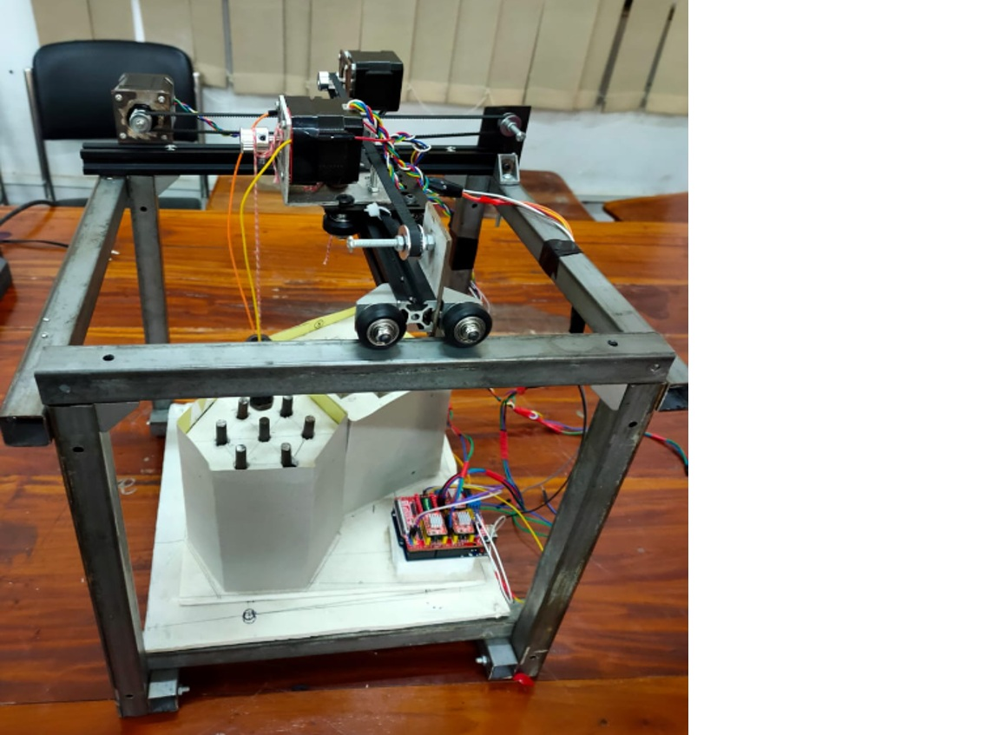

# Design of an Automated Nuclear Fuel Handling Machine

This project focuses on the design and development of a prototype automated nuclear fuel handling machine using a Cartesian robotic gantry system. The system operates along three axes (X, Y, and Z) and is controlled by an Arduino microcontroller to simulate the loading and unloading of nuclear fuel rods.

The prototype integrates mechanical and electrical components to demonstrate precise fuel rod positioning and transportation between a simulated nuclear reactor and a spent fuel pool. The primary objective is to reduce human intervention in nuclear fuel handling, minimize radiation exposure risks to workers, and improve operational safety and efficiency.

The system was tested using dummy fuel rods, and the results demonstrated accurate positioning and efficient operation. Its simple design and minimal component requirements also offer potential cost advantages.

**Features:**
- Three-axis Cartesian robotic gantry mechanism.
- Arduino-based control system.
- Automated fuel rod loading and unloading simulation.
- Accurate positioning and efficient movement.
- Focus on radiation safety and reduced human intervention.
- Cost-effective prototype design.

Figure: Developed prototype of the automated nuclear fuel handling machine.
